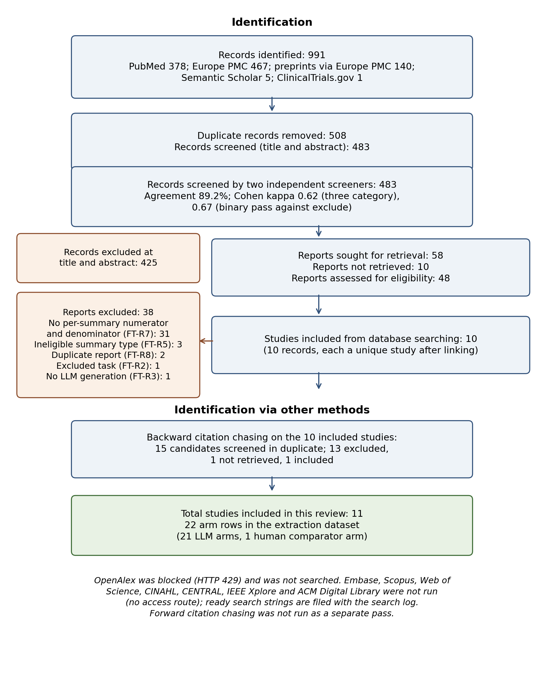
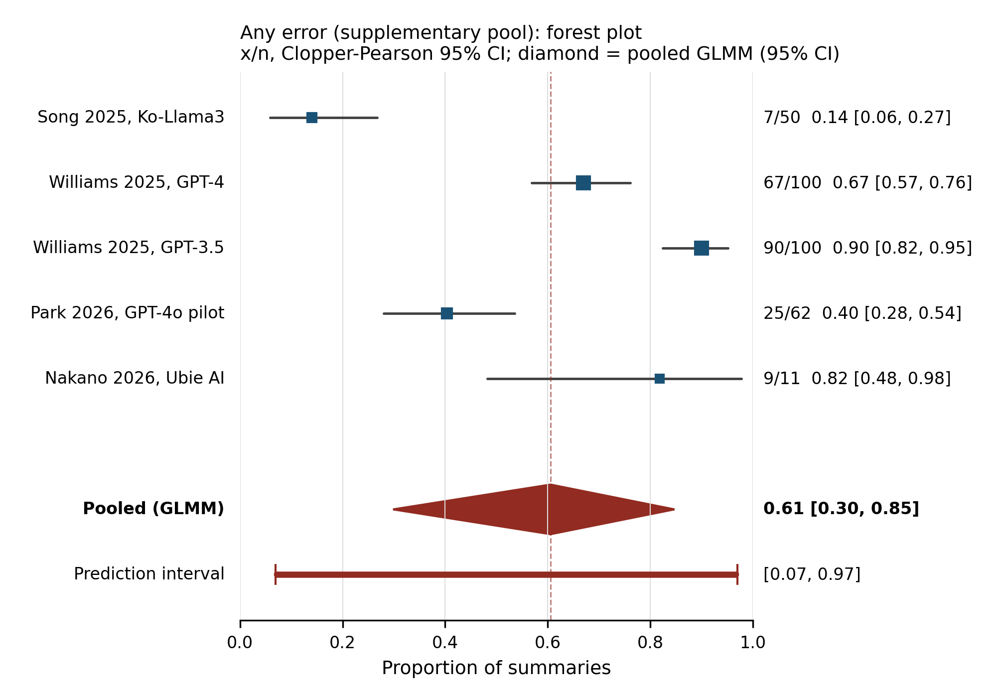
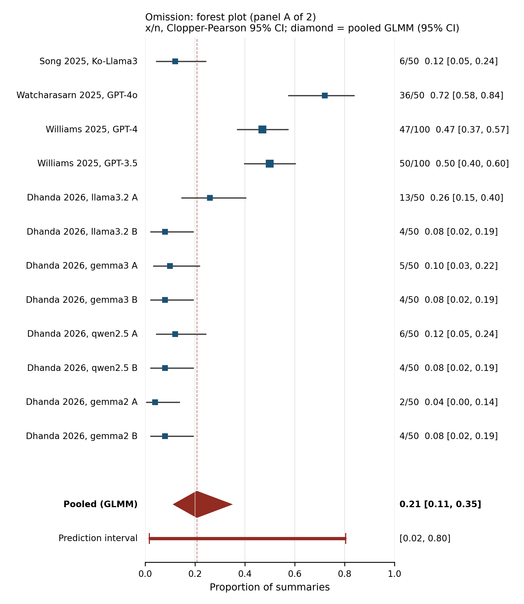
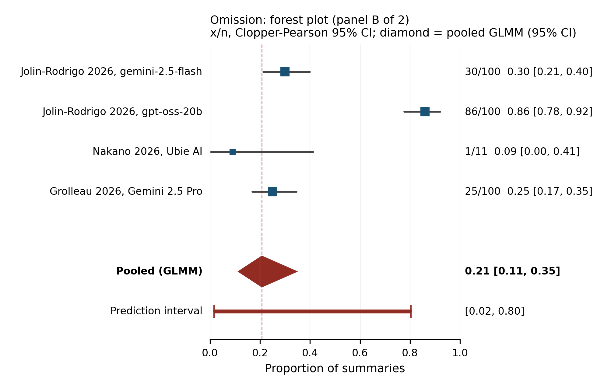
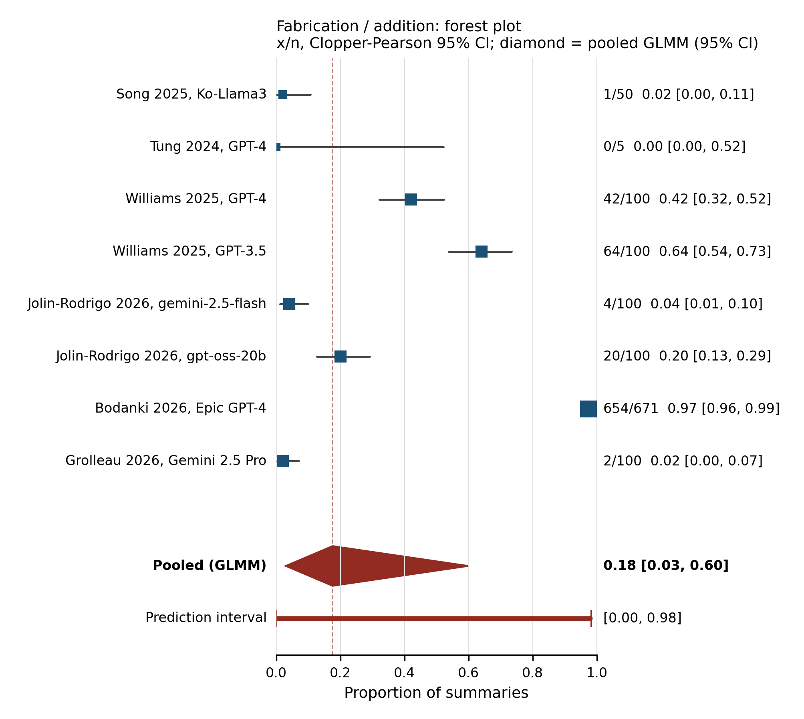
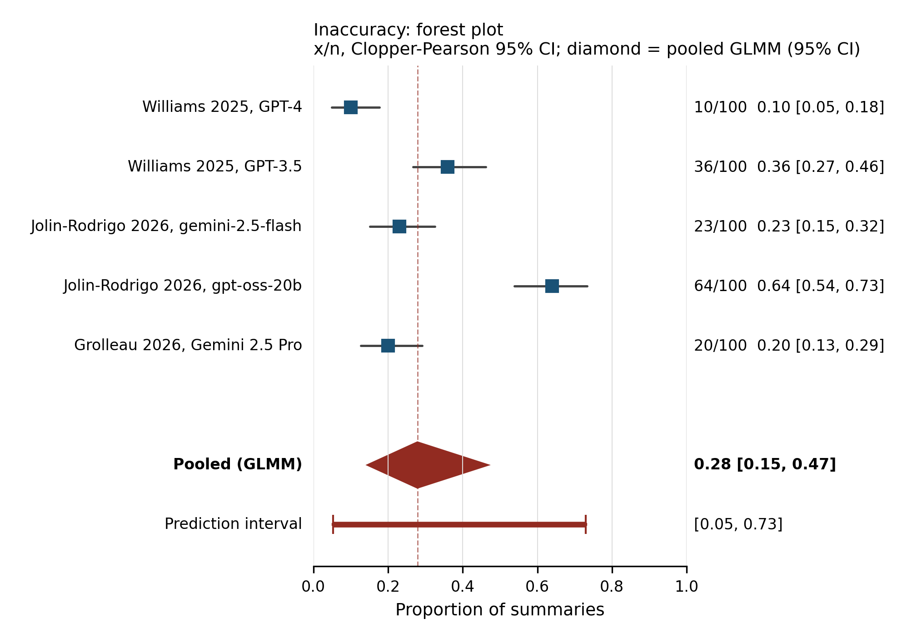

# 📄 Download the full article — PDF

**[Click here to download the PDF](https://github.com/rtmalikian/llm-clinical-summarization-errors-meta-analysis/raw/main/manuscript.pdf)**

One click — no sign-up, no paywall.

---

# Clinically Significant Errors in Large Language Model-Generated Clinical Summaries: A Systematic Review and Meta-analysis of Omissions, Inaccuracies and Fabrications per Summary

Raphael Malikian. Independent researcher, Palmdale, CA, USA. ORCID: [0009-0008-4326-4205](https://orcid.org/0009-0008-4326-4205)

Cochrane-level systematic review and meta-analysis (Cochrane Handbook v6.5 structure; this is not a Cochrane review and was not submitted to Cochrane). Researched and written by an LLM research team under one accountable human author. The author is a healthcare founder and operator who bootstrapped and ran a direct primary care clinic as CEO, now building clinical AI.

Reading page for non-GitHub users: https://rtmalikian.github.io/llm-clinical-summarization-errors-meta-analysis/

Preprint: Zenodo deposit pending; the DOI will be added here when the record is live.

## Abstract

**Background.** Large language models (LLMs) now draft clinical summaries inside electronic health record workflows: discharge summaries, hospital-course narratives, emergency department encounter summaries, progress-note summaries, referral letters and clinic-visit summaries. A clinician reads and signs each summary, and an error in it can travel with the patient. Single studies report error counts in very different ways, and no review has pooled, across summary types, the proportion of summaries that contain at least one clinically significant error, using the individual summary as the denominator throughout.

**Objectives.** To estimate the proportion of LLM-generated clinical summaries that contain at least one clinically significant error (study-defined), and the proportions with at least one omission, at least one fabrication or addition, and at least one inaccuracy, together with errors per summary, the proportion rated as carrying potential harm of at least moderate level, and any matched comparison with human-written summaries.

**Search methods.** We searched PubMed (378 records), Europe PMC (467), preprints through Europe PMC (140), Semantic Scholar (5) and ClinicalTrials.gov (1) on 31 October 2026, for studies published from 2022 to 2026, and we chased the reference lists of the included studies. OpenAlex was blocked by a provider rate limit and was not searched. Embase, Scopus, Web of Science, CINAHL, CENTRAL, IEEE Xplore and the ACM Digital Library were not run because no access route was available. This review has no PROSPERO registration number. A PROSPERO-ready form was prepared on 31 October 2026, before screening closed.

**Selection criteria.** Empirical evaluations in which an LLM generated a clinical summary from existing electronic health record source data (real or synthetic) and the study reported the number of summaries assessed and the number with errors, or data from which both could be derived. Patient-facing simplification or translation, radiology or pathology report generation from images, ambient scribe encounter notes, reviews and frameworks with no primary error counts were excluded.

**Data collection and analysis.** Screening, extraction and risk of bias assessment were each done twice, independently, by an LLM team working under one accountable human author, with every disagreement settled by reading the source. Title and abstract screening agreement gave a Cohen kappa of 0.62 for three categories and 0.67 for the binary pass or exclude split. Risk of bias used an adapted QUADAS-2 tool for LLM clinical summarisation evaluations (adapted from QUADAS-2 with QUADAS-AI signalling questions), named as adapted at every mention. Proportions were pooled with a random-effects generalised linear mixed model with a logit link, fitted in Python (scipy) with adaptive Gauss-Hermite quadrature because R was not available in the build environment. Certainty was rated with GRADE.

**Main results.** The search found 991 records. After 508 duplicates were removed, 483 records were screened, 48 reports were assessed in full, and 10 studies were included. Citation chasing added 1 study, giving 11 studies and 22 extraction arms (21 LLM arms and 1 human arm). The primary outcome could not be pooled: only 1 of the 11 studies reported the number of summaries with at least one clinically significant error, a prospective pilot in which 13 of 62 summaries (21.0 percent, exact 95 percent CI 11.7 to 33.2) carried a critical, treatment-impacting error, and even that count is ambiguous in the source text. A supplementary pool of summaries with at least one error of any audited type, specified post hoc in Amendment 01 and labelled as such throughout, gave 60.6 percent (95 percent CI 29.8 to 84.7; 5 units, 4 studies, 323 summaries; prediction interval 6.9 to 97.0). Omissions were pooled at 20.7 percent (95 percent CI 11.5 to 34.6; 16 units, 7 studies, 1011 summaries), rising to 40.6 percent (95 percent CI 22.0 to 62.4) when a study that counted omission of a single risk fact was removed. Fabrication or addition was pooled at 17.6 percent (95 percent CI 2.9 to 60.0; 8 units, 6 studies, 1226 summaries), a figure dominated by one outlying unit and close to uninterpretable as a single frequency. Inaccuracy was pooled at 27.9 percent (95 percent CI 14.6 to 46.7; 5 units, 3 studies, 500 summaries). One study rated 1 of 100 summaries as likely to cause moderate harm (1.0 percent, exact 95 percent CI 0.03 to 5.4). Errors per summary could not be pooled, and no study reported matched LLM and human error counts, so the LLM versus human contrast could not be fitted. Heterogeneity was very high in every pool (I squared above 93 percent). Nine of 11 studies were at high overall risk of bias on the adapted tool, 2 were at some concerns and none was at low risk. Certainty was very low for every rateable outcome, and the LLM versus human contrast was not rateable because there was no evidence.

**Authors' conclusions.** Errors are common in LLM-generated clinical summaries in the studies that counted them per summary, and the graded, clinically significant end of the error spectrum is the part the literature reports least. The finding of this review is as much about reporting as about frequency: a field that rarely counts clinically significant errors per summary cannot yet say how often its summaries are wrong in a way that matters. Studies should report, for every summary type and model, the number of summaries assessed, the number with at least one error of each type, and the number with at least one error graded clinically significant, so that the next review can pool the primary outcome this one could not.

## Plain language summary

**The problem.** Computer programs called large language models can write clinical summaries, the short documents that describe a hospital stay, an emergency visit or a clinic appointment. Clinicians use these summaries to hand care from one person to another. If a summary leaves something out, changes a fact, or adds something that never happened, the next clinician may act on wrong information. We wanted to know how often that happens, counting one summary at a time.

**What we did.** We searched medical databases for studies from 2022 to 2026 in which a large language model wrote clinical summaries and researchers checked each summary against the patient record and counted the mistakes. We found 11 studies. Every study was checked twice, disagreements were settled by reading the papers again, and we combined the counts with statistical models that allow the true rate to differ between studies.

**What we found.** Most studies counted any mistake, but only one study counted the mistakes it classed as serious, meaning errors it judged could change treatment. In that study, 13 of 62 summaries (21.0 percent) had such an error. Across the studies that counted mistakes of any kind, about 3 in 5 summaries had at least one. About 1 in 5 summaries missed something from the record, about 1 in 4 contained an inaccurate statement, and counts of invented content ranged from none at all to nearly every summary, depending on how the study counted. One study rated 1 summary in 100 as likely to cause moderate harm. No study counted errors in model-written and human-written summaries of the same records in the same way, so we cannot say which is safer.

**What this means.** These systems write summaries with errors often enough that each summary needs a careful check against the record before it is used. The studies disagree with each other a great deal, and our confidence in every combined figure is very low. Until studies count serious errors per summary as a routine step, nobody can give a firm overall rate.

## Results at a glance

- Records identified: 991. After deduplication: 483 screened, 48 reports assessed in full, 11 studies included (22 arms: 21 LLM, 1 human).
- Primary outcome (summaries with at least one clinically significant error): NOT POOLED. Only 1 of 11 included studies reported it (Park 2026 pilot, 13 of 62, 21.0 percent, exact 95 percent CI 11.7 to 33.2).
- Reporting gap: of the 48 reports assessed in full, 31 (65 percent) reported no extractable per-summary error count (Table 5 of the paper classifies all 31).
- Summaries with at least one error of any audited type (supplementary, post hoc, Amendment 01): 60.6 percent (95 percent CI 29.8 to 84.7; 5 units, 4 studies, 323 summaries; prediction interval 6.9 to 97.0).
- Omissions: 20.7 percent (11.5 to 34.6; 16 units, 1011 summaries). Excluding one fact-specific study: 40.6 percent (22.0 to 62.4).
- Fabrication or addition: 17.6 percent (2.9 to 60.0; 8 units, 1226 summaries). The paper warns this pool is close to uninterpretable as a single frequency; unit-level figures carry the information.
- Inaccuracy: 27.9 percent (14.6 to 46.7; 5 units, 500 summaries).
- Harm at least moderate: single unit, 1 of 100 summaries (1.0 percent).
- Certainty (GRADE): very low for every rated outcome. The LLM versus human comparison could not be fitted and is not rateable.

## PRISMA 2020 flow

## Figures

## Files in this repo

- `manuscript.pdf` and `manuscript.md`: the full review.
- `data/extraction-settled.csv`: settled extraction, one row per arm.
- `data/rob-settled.csv`: settled risk of bias judgements.
- `data/fulltext-decisions-merged.csv`: full-text decisions with exclusion reasons.
- `data/results-summary.csv` and `data/poolability-table.csv`: analysis outputs.
- `data/ft-r7-reporting-gap.csv`: the reporting-gap classification behind Table 5.
- `code/analysis.py` and `code/figures.py`: the analysis and figure code. Rerunning the analysis from the posted data reproduces the posted numbers.
- `prisma-2020-checklist.md` and `prisma-s-checklist.md`: reporting checklists.

## Methods note (software disclosure)

R and the metafor package were not available in the build environment. The random-effects GLMM (logit link) specified in the protocol was fitted with a hand-written Python (scipy) implementation using adaptive Gauss-Hermite quadrature, and the pooled result was hand-checked by a separate integration route; the two matched to rounding. A first, non-adaptive quadrature implementation was discarded before any number was reported.

Registration: no PROSPERO number was issued for this review. The protocol was timestamped in a public repository before screening.

## Declarations

Funding: none. Competing interests: none; the review was conducted fully independently of the author's commercial work. AI assistance: the searches, screening, extraction, risk of bias assessment and analysis were carried out by an LLM research team working under the accountable human author, who verified the numbers in this paper against the source data; the disclosure wording follows the RAISE 2025 statement. Scope: this paper is evidence synthesis and reporting-practice discussion only. It contains no clinical or medication advice.

## How to cite

Malikian R. Clinically Significant Errors in Large Language Model-Generated Clinical Summaries: A Systematic Review and Meta-analysis of Omissions, Inaccuracies and Fabrications per Summary. 2026. Zenodo DOI to be added on deposit.

## Licence

Text and data: CC BY 4.0. Code: MIT.
